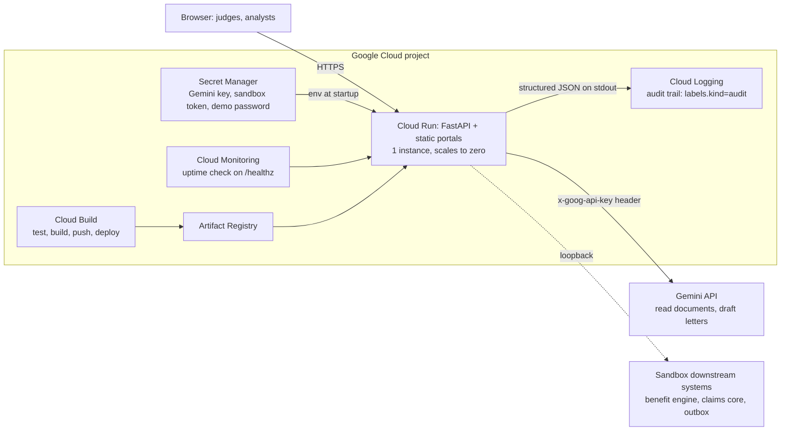

# Payer Lifecycle Console

**Every payer decision, explained and sourced.** One operations console for health insurers and TPAs, in the US and India:
policy document to verified rules, rules to a clause-cited claim decision, decision to an appeal only when the rules support one.
**AI reads. Rules decide. People confirm.**

| | |
|---|---|
| **Live demo** | `https://<your-service>.run.app` (fill in after `deploy/deploy.sh` prints it) |
| **Sign in** | One click on a role card. Accounts below; the password is on the sign-in page or supplied with the submission. |
| **Built on** | Gemini API, Cloud Run, Cloud Build, Artifact Registry, Secret Manager, Cloud Logging, Cloud Monitoring |
| **Data** | All synthetic: plans, bills, tariffs, letters. No real patient data. |

## The problem

Payer operations run on documents people read by hand. A benefit analyst keys a plan's limits into the claims system;
a claims analyst applies them line by line; a patient or hospital receives a reduced payment without the clause that caused it,
and contests it. Each hand-off can introduce a keying error that nobody can trace back to the policy wording.

Generic AI does not fix this on its own: an LLM that *decides* amounts cannot be audited. This console uses Gemini where it is strong
(reading documents, drafting letters) and keeps every amount in a deterministic engine, with a person approving each step.
Every AI output is verified in code against its source before anyone can approve it.

## What is built

Ten payer processes appear as heat-map tiles. Three are built end to end, each with agents started by a **Run agent** button:

| Module | Agents | What a person gets |
|---|---|---|
| **Benefit Plan Interpretation & Coding** | Interpretation (Gemini), Configuration & Coding, Validation | Rules with page, clause and exact quote, verified against the PDF; a system-ready payload; boundary tests that catch a keying error |
| **Claims Adjustments & Reprocessing** | Intake (Gemini), Adjudication (deterministic), Explanation (Gemini) | A line-by-line decision where every reduction cites its clause; a patient letter whose every number is checked |
| **Denial Mgmt & Appeals** | Classification (Gemini), Policy Recheck (deterministic), Drafting (Gemini) | A correction note before a wrong decision goes out, or an appeal only when the published rules support one |

## Architecture



- **One FastAPI service** serves the API and the static pages. The sandbox systems the agents push to are part of the same service and are called over loopback.
- **Gemini proposes, code verifies, people approve.** Quotes must exist in the document, values must appear in their quote, and every amount and clause in a letter must exist in the computed facts. A failed check blocks approval.
- **The engine is deterministic** (`backend/engine.py`): the same rules and claim always give the same amounts, which is what makes each decision explainable.

### Google products and why each is used

| Product | Used for | Free tier fit |
|---|---|---|
| **Gemini API** (AI Studio key) | Reading policies, bills and letters (including PDFs and scans); drafting letters and appeals | AI Studio free tier; a per-account agent limit protects the quota |
| **Cloud Run** | Hosting the app over HTTPS | Scales to zero; CPU billed only during requests; max 1 instance |
| **Cloud Build** | CI/CD: runs all tests, then builds and deploys. A failing test stops the deploy | Free build-minutes each month |
| **Artifact Registry** | Container images | Cleanup policy keeps 3 images, inside the free 0.5 GB |
| **Secret Manager** | Gemini key, sandbox token, demo password. Never in the image or repo | Three secrets, inside the free allowance |
| **Cloud Logging** | Every audit event as a structured, labelled entry that survives restarts | Within the free monthly allotment |
| **Cloud Monitoring** | Uptime check on `/healthz` | Free |

## Security

Full list in [SECURITY.md](SECURITY.md). In short:

- **Access control on the server** for every endpoint, by role. The acting user always comes from the session, never from the request. Whoever publishes rules cannot also decide claims.
- **Sessions:** random 256-bit tokens, HttpOnly, `Secure` and `SameSite=Lax` cookies, idle and absolute expiry. Passwords hashed with PBKDF2-HMAC-SHA256 (600,000 iterations), lockout after repeated failures.
- **Browser hardening:** Content-Security-Policy, HSTS, `X-Frame-Options: DENY`, `nosniff`, no referrer, cross-site POSTs blocked.
- **Secrets:** Secret Manager on Cloud Run, `.env` locally (git-ignored, never copied into the image). The Gemini key is sent in a header, never in a URL.
- **Least privilege:** a runtime service account that can read only its three secrets; a separate build account. The container runs as a non-root user.
- **Abuse limits:** per-account limit on agent runs; upload size limits; the connectors can call only the app's own host or loopback (no SSRF).

## Demo accounts

| Username | Role | Can do |
|---|---|---|
| `meera` | Benefits analyst | Benefit tile: load documents, run the agents, approve rules, publish |
| `arjun` | Claims analyst | Claims and Denials tiles: load claims, run the agents, decide, approve letters |
| `kavita` | Operations manager | Read everything |

To demo end to end: sign in as `meera`, publish a rule set, sign out, sign in as `arjun`.
The live demo keeps its state in memory: it is shared by everyone signed in and resets when the service restarts.

## Run locally

```
pip install -r requirements-dev.txt
cd backend
python -m uvicorn app:app --port 8110
```

Open http://localhost:8110/. For the live Gemini path, copy `.env.example` to `.env`, set `GEMINI_API_KEY`, restart,
and check it with `python scripts/check_gemini.py`. Without a key the agents use a labelled rule-based fallback that only
understands the demo document format, and PDF or image upload is refused with a clear message.

## Tests

```
python -m unittest discover -s tests
```

131 tests: the Benefit agents, the engine (both markets, hand-checked amounts), the Claims and Denials agents, letter verification,
reference tables, connections and the sandbox, the API flow, access control, and the deployment hardening
(security headers, secure cookies, rate limits, key handling). Cloud Build runs them before every deploy.

## Deploy to Google Cloud

See [docs/DEPLOY.md](docs/DEPLOY.md). From Cloud Shell: `bash deploy/setup.sh` once, then `bash deploy/deploy.sh`.

## How each module works

### Benefit module

Nothing runs until a person clicks **Run agent**. Each agent shows its recorded steps, then its results.

1. **Document:** click a sample (US plan, India policy, or an amendment), or upload a text file / paste text. PDFs and images need the Gemini key.
2. **Interpretation Agent:** proposes rules with page, clause and exact quote. Code then verifies every quote exists in the document and every value appears in its quote. A person approves, rejects or edits each rule. India: the proportionate-deduction scope is an explicit reviewer decision.
3. **Configuration & Coding Agent:** needs every rule decided. Builds the benefit model, a system-ready payload (JSON, fields, CSV) and service-to-code mappings from an effective-dated crosswalk. Flags missing, one-to-many and expired mappings. A coding reviewer confirms flagged ones.
4. **Validation Agent:** generates boundary-case scenarios, computes the expected result from the approved rules, runs the **loaded** configuration through a deterministic engine, and reports differences as defects. Tick "Simulate a keying error" to watch it catch one.
5. **Approve and publish:** versioned rule set. Loading the amendment then shows what changed against it.

### Claims module (needs a published rule set)

1. **Claim:** click a sample claim (bill, plus discharge summary and approval letter where relevant), or paste a bill. Scans and PDFs need Gemini.
2. **Intake Agent:** reads the bill into lines, verifies every description and amount against the document, matches items to tariff codes, and cross-checks bill, discharge summary and approval letter (totals, patient, dates, procedure, signature, authorization).
3. **Adjudication Agent:** no AI. The deterministic engine applies the **published** rules line by line. Every reduction cites its clause and page, with the policy wording one click away. Flags: above-tariff charges, duplicates, missing pre-authorization, failed document checks. If the rules change, the claim shows as stale and re-running it shows what changed.
4. **Explanation Agent:** Gemini writes the letter from the computed facts only (a template if there is no key). Code then checks that every amount and clause in the letter exists in those facts. A draft with an invented number is rejected and replaced.
5. **Reviewer decision:** approve, query the hospital, or refer to the insurer's medical team. Approval is blocked when a document check failed.

### Denials module

Two lenses on the same agents, chosen when you open a workspace:

- **Pre-issue audit** (insurer or TPA payment-integrity team): the decision the claims system drafted is rechecked against the published rules **before** the letter goes out. A wrong decision gets a **correction note** to the adjudication team. A correct one is cleared to issue and nothing is drafted.
- **Contest** (hospital billing desk or patient advocate): a decision that was **already issued** is checked. An appeal or a clarification request is drafted only if there is something to contest, with documents to enclose and the escalation path (timelines marked unverified).

Steps: pick a claim explained in the Claims module; **Classification Agent** (reads the letter, verifies each amount, finds root causes and pre-emptive edits); **Policy Recheck Agent** (no AI, compares each deduction with the published rules); **Drafting Agent** (correction note or appeal, verified against the recheck facts); a person approves. Nothing leaves the sandbox.

### Shared module layout

- **Overview:** hero, three live KPIs, **Launch Demo**, and what each agent does. The KPIs are computed from live state. There are no time-saving or accuracy figures, because none have been measured.
- **Agents:** one page per workflow, in order, with Previous and Next buttons.
- **Reference tables:** the data the agents work from (crosswalk, rule set, tariff, policyholders, reason codes, escalation path).
- **Settings (System Configuration):** one tab per connection, with **Test connection** and **Edit**. A connection shows *Connected* only after a real test passed. The downstream systems are a sandbox built into this app; they need a bearer token and keep what they receive.

### Documents, provenance and templates

- **Documents open as real PDFs** in a full-size viewer, rendered from the PDF itself.
- **Page and clause provenance.** Each rule shows the page and clause it was read from. Click the tag and the PDF opens on that page with the clause highlighted. Code checks the quote sits in exactly that clause on exactly that page, whoever extracted it, and a rule that fails cannot be approved.
- **The patient letter template is configurable** (Claims, Configuration, Letter template). Every letter, from the template or from Gemini, is still checked.

### How the India proportionate deduction is modelled

- **The policy wording governs.** The IRDAI Master Circular on Health Insurance Business (29 May 2024) sets the 1-hour cashless and 3-hour discharge decisions and requires sub-limits to be disclosed, but it has **no clause on proportionate deduction or room rent**.
- The sample wording lists the room-linked charges (surgeon, anaesthesia, nursing, operation theatre fees) and says implants, medicines, consumables and diagnostic tests are **not reduced**. Those categories are protected in the engine.
- **ICU is the flagged reviewer decision**, because the wording is silent and published explanations disagree. On the ICU sample claim (CLM-IN-2005) the decision changes the plan's payment between Rs. 1,33,000 and Rs. 1,42,600.
- The demo ground is verifiable from the policy text: the insurer's system applied the ratio to the implant, so it paid Rs. 1,25,000 where the published rules give Rs. 1,61,000.

## Honest status

- Amounts, deductions and the appeal check are deterministic by design. Gemini reads and drafts; every AI output is verified against the source or the computed facts.
- Demo state is in memory (one Cloud Run instance). The audit trail is also written to Cloud Logging, which survives restarts; runs and cases do not.
- No multi-factor sign-in. Demo accounts share one password by design, so judges can get in.
- Regulatory timelines and the India proportionate-deduction scope are unverified and labelled so in the product. Drafts are not legal advice.
- CPT and CDT descriptions are licensed. The demo shows code numbers with our own descriptions.
- Not built yet: persistence, the other seven tiles.

## Repository layout

- `backend/`: `app.py` (API, sign-in, roles, security headers, rate limits), `config.py` (settings), `logs.py` (Cloud Logging), `ai.py` (Gemini), `auth.py`, `ratelimit.py`;
  agents `interpret.py`, `configure.py`, `validate.py` (Benefit), `claims.py`, `denials.py` (Claims and Denials); `engine.py` (deterministic benefit engine);
  `service.py` and `casework.py` (state); `reference.py`, `connectors.py` (reference tables, connections and the sandbox); `docparse.py`, `docpdf.py`, `rulespec.py`
- `portals/`: landing and sign-in, console heat-map, `benefits/`, `claims/` and `denials/` modules, shared `module.js`, `agents.js`, `pdfview.js`
- `data/`: market packs (`market_us.json`, `market_in.json`) and synthetic plan documents with amendments
- `deploy/`, `cloudbuild.yaml`, `Dockerfile`: Google Cloud setup and CI/CD ([docs/DEPLOY.md](docs/DEPLOY.md))
- `tests/`, `scripts/check_gemini.py`, `design/` (the earlier static prototype)
